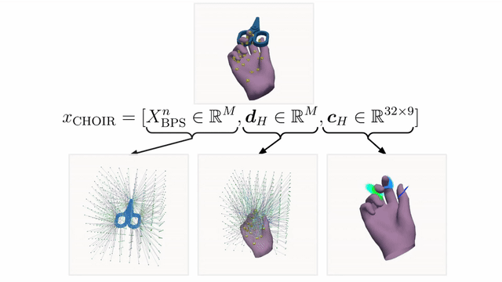

<br />
<p align="center">
  <h1 align="center">CHOIR: a Versatile and Differentiable Hand-Object Interaction Representation</h1>
  <p align="center">
    <a href="https://theomorales.com"><strong>Théo Morales</strong></a>
    ·
    <a href="https://otaheri.github.io/"><strong>Omid Taheri</strong></a>
    ·
    <a href="https://www.maynoothuniversity.ie/faculty-science-engineering/our-people/gerard-lacey"><strong>Gerard Lacey</strong></a>
  </p>
  <h4 align="center">WACV 2025</h4>

  <p align="center">
    <!-- <a href="https://pytorch.org/get-started/locally/"></a><br><br> -->
    <a href='https://arxiv.org/abs/2409.16855'>
      
    </a>
    <a href='https://dubiouscactus.github.io/CHOIR/'>
      
    </a>
  </p>
  <p align="center">
    
  </p>
</p>

**CHOIR** (Coarse Hand-Object Interaction Representation) encodes hand-object interactions as
unsigned distances over a regular grid (BPS) plus 32 probabilistic contact Gaussians.
**JointDiffusion** is a conditional DDPM (3D U-Net + contact branch) that both *refines* noisy
grasps (denoising) and *synthesizes* grasps (generation), evaluated against ContactOpt, TOCH
and GraspTTA.

> T. Morales, O. Taheri, G. Lacey.
> *A Versatile and Differentiable Hand-Object Interaction Representation.* arXiv:2409.16855.

## Setup

Requires Python 3.11 and [uv](https://docs.astral.sh/uv/getting-started/).

```bash
git clone --recursive git@github.com:DubiousCactus/CHOIR.git
cd CHOIR
uv sync                       # creates .venv and installs everything, incl. pytorch3d
```

Download the pretrained checkpoints from the
[releases page](https://github.com/DubiousCactus/CHOIR/releases/tag/weights-v1) into the repo root:

```bash
gh release download weights-v1     # multimodal.ckpt, graspTTA_cvae.ckpt, graspTTA_contactnet.ckpt
```

**MANO assets (license-gated).** The datasets and the evaluation rely on MANO, which requires a
free registration at [http://mano.is.tue.mpg.de](http://mano.is.tue.mpg.de). Place the model files
in `vendor/manotorch/assets/mano/models/` (`MANO_RIGHT.pkl`, and `MANO_LEFT.pkl` for OakInk):

```
vendor/manotorch/assets/mano/models/MANO_RIGHT.pkl
vendor/manotorch/assets/mano/models/MANO_LEFT.pkl
```

**Data.** Everything under `data/*_preprocessed/` is precomputed (BPS/CHOIR fields); the code
loads those caches directly and never needs the raw datasets for training or evaluation *unless
a cache is missing*. Datasets used by the experiments:

| Dataset | Location | Cached? |
| --- | --- | --- |
| ContactPose (perturbed) | `data/ContactPose_preprocessed/` | yes |
| OakInk | `data/OakInk_preprocessed/` (tiny subset) | yes |
| GRAB | raw GRAB release at `/Users/<you>/Code/GRAB` (set via `dataset.root_path`) | no |

Evaluating the object-mesh metrics (intersection volume, contact F-score, simulation
displacement) additionally needs the raw ContactPose object meshes; pose metrics (MPJPE,
R-MPJPE, MPVPE) do not.

**GRAB** additionally needs the SMPL-X MANO models: set `SMPLX_MODEL_PATH`
(`conf/project.py`, or the `SMPLX_MODEL_PATH` environment variable).

## Usage

Run configurations are managed with [hydra-zen](https://mit-ll-responsible-ai.github.io/hydra-zen/)
stores; see `conf/experiment.py` for every experiment and its hyperparameters. Each run creates an
isolated `runs/<name>/` directory with the resolved config, checkpoints and logs.

**Train** (e.g. the full JointDiffusion model on Perturbed ContactPose):

```bash
uv run train.py +experiment=coddpm_3d_multiview_contactopt_multimodal
```

Resume/initialize from a checkpoint with `run.load_from=<run_name or .ckpt path>`. On a machine
without a GPU, everything runs on CPU/MPS out of the box; on MPS add
`PYTORCH_ENABLE_MPS_FALLBACK=1` (a few ops, e.g. `avg_pool3d`, fall back to CPU).

**Evaluate** a checkpoint:

```bash
uv run test.py +experiment=coddpm_3d_multiview_contactopt_multimodal \
    run.load_from=multimodal.ckpt \
    model.contacts_hidden_dim=2048 model.conv_transpose=true
```

> [!NOTE]
> The released `multimodal.ckpt` was trained with the previous architecture size
> (`contacts_hidden_dim=2048`, `conv_transpose=true`), hence the two model overrides. Retraining
> from the current config does not need them. Use `run.inference_mode=generation` for grasp
> synthesis.

**Experiments** (`uv run {train,test}.py +experiment=<name>`):

| Experiment | Purpose |
| --- | --- |
| `coddpm_3d_multiview_contactopt_multimodal` | Full JointDiffusion, Perturbed ContactPose (refinement) |
| `coddpm_3d_multiview_contactopt_noisy_pair` / `_object` | Denoising / synthesis variants (conditioning on the noisy pair / object only) |
| `coddpm_3d_multiview_oakink_*` | OakInk (multimodal variant, Appendix C.5) |
| `coddpm_3d_multiview_grab_*` | GRAB sequences (`tester=seq_ddpm`) |
| `cddpm_3d_multiview_contactopt` | Ablation: JointDiffusion without the contact branch (Table 3, "+BPS") |
| `baseline_cddpm_3d_multiview_contactopt` | Keypoint-diffusion baseline (Table 3) |
| `grasp_tta_cvae_contactpose` / `grasp_tta_contactnet_contactpose` / `grasp_tta_wrapped_contactpose` | GraspTTA baseline (train CVAE / train ContactNet / wrapped TTA eval) |
| `toch_contactpose` | TOCH baseline evaluation |

Useful flags: `dataset.tiny=true` (subset), `run.epochs=N`, `run.viz_every=N`,
`run.compute_iv/compute_contact_scores/compute_sim_displacement` (mesh-based metrics),
`run.max_observations` (number of input observations at test time), `run.save_predictions=true`.

## Project structure

```
conf/experiment.py      <- all experiment/store definitions (hydra-zen)
dataset/                <- ContactPose / OakInk / GRAB / TOCH loaders (cache-first)
model/diffusion_model.py<- ContactsBPSDiffusionModel (JointDiffusion), BPSDiffusionModel (+BPS), KPDiffusionModel (baseline)
model/backbones.py      <- 3D U-Net backbone, contact branch, context encoders
src/base_trainer.py     <- training loop, checkpointing, wandb, EMA
src/base_tester.py      <- N-observation evaluation, TTO fitting, metrics
src/ddpm_trainer.py     <- JointDiffusion trainer   src/ddpm_tester.py <- its tester
src/losses/             <- DDPMLoss, fitting losses, GraspTTA losses
utils/                  <- BPS/CHOIR computation, TTO fitting, metrics, visualization
vendor/                 <- submodules: manotorch (assets), ContactPose, OakInk (only needed to rebuild caches)
```

## Notes

- `pre-commit run --all-files` keeps the code formatted (black/isort/autoflake).
- TOCH evaluation needs the TOCH weights and its preprocessed ContactPose contacts; point
  `model.model_path` and `dataset.processed_root` at them. `psbody-mesh` is optional (a warning
  is printed if absent).
- The GraspTTA checkpoints are evaluated through `grasp_tta_wrapped_contactpose` with
  `model.graspCVAE_model_pth=graspTTA_cvae.ckpt model.contactnet_model_pth=graspTTA_contactnet.ckpt`.
